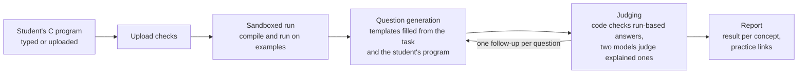

# Nabeegh Khan

I build ML and LLM systems in Python, and the web and cloud services around them.

MEng in Electrical and Computer Engineering, University of Toronto. Looking for full-time ML, AI, data and software roles from May 2027.

## Featured work

| Project | What it does | Architecture | Result |
| --- | --- | --- | --- |
| **cAIro**, my MEng project Private repository | A conversational agent that tests students' understanding of C programs they wrote. Designed from over 90 papers. | Python backend with sandboxed runs, a job queue and PostgreSQL. Mobile-first React front end. | Over 1,000 tests, with Playwright end-to-end tests in CI. Built for a January pilot. |
| **AI-M**, University of Toronto Private repository | An LLM pipeline that extracts depression (PHQ-8) and PTSD (PCL-C) evidence from clinical interview transcripts. I lead a team of two. | Every piece of evidence must be an exact quote, checked in code. | Precision 0.53 to 0.66 on 17 sessions against a psychiatrist-annotated key. Expected calibration error 0.24 to 0.05. Over 300 tests in required CI. |
| **JurisEngine**, Vector Institute FastLane Private repository | Jurisdiction-aware retrieval for Canadian employment law, built in five days. | Code resolves the province and the law in force before retrieval. The LLM only phrases an answer a validator checks. | Met all four success metrics in CI; 100% jurisdiction precision over 27,918 served citations. |
| [**ContentCollab**](https://github.com/nabeegh-khan/contentcollab), team of four | A cloud application for reviewing documents together, live on DigitalOcean Kubernetes. | My part: architecture, cluster, worker service, browser client. Autoscaling from two to five API pods. | Load tests at up to 250 requests a second. A deploy gate rolled a broken release back on the live cluster. |
| [**FitnessCoach**](https://github.com/harunm1/FitnessCoach), team of four | A Next.js and TypeScript web app with an AI workout coach. | My part: the foundation and the LLM coach, with streamed replies, guardrails and provider failover. | A CSV import that checks every row before it reaches PostgreSQL. |

Also: education research with Dr. Qin Liu (ASEE 2027, CEEA 2027).

## How cAIro works

No model writes a question; each is a template filled from the student's program.

## Stack

**Machine learning and LLMs:** Python, PyTorch, Hugging Face Transformers, PEFT and LoRA, scikit-learn, pandas, OpenAI API, RAG, ChromaDB, RAGAS, ONNX

**Data and MLOps:** Kafka, Spark, DuckDB, dbt, MLflow, FastAPI, Docker

**Web and cloud (graduate coursework):** TypeScript, React, Next.js, Node.js, Express, PostgreSQL, Prisma, Supabase, Vercel, Kubernetes, Prometheus and Grafana, DigitalOcean

**Engineering practice:** Git, GitHub Actions, pytest, Jest, Playwright, pull-request review, Claude Code

## Earlier ML repos

[3gpp-rag](https://github.com/nabeegh-khan/3gpp-rag) · [real-time-anomaly-mlops](https://github.com/nabeegh-khan/real-time-anomaly-mlops) · [6g-lwm-beam-prediction](https://github.com/nabeegh-khan/6g-lwm-beam-prediction) · [Ontario-Electricity-Demand-Forecasting](https://github.com/nabeegh-khan/Ontario-Electricity-Demand-Forecasting) · [cadusd-cot-feature-engineering](https://github.com/nabeegh-khan/cadusd-cot-feature-engineering) · [canada-innovation-policy-analysis](https://github.com/nabeegh-khan/canada-innovation-policy-analysis)

## Background

Before graduate school I spent nearly six years in engineering.

## How I use AI

Each README says which parts AI wrote and which I designed and checked.

[LinkedIn](https://www.linkedin.com/in/nabeeghkhan/) · nabeegh.as.khan@gmail.com · Cambridge, Ontario
